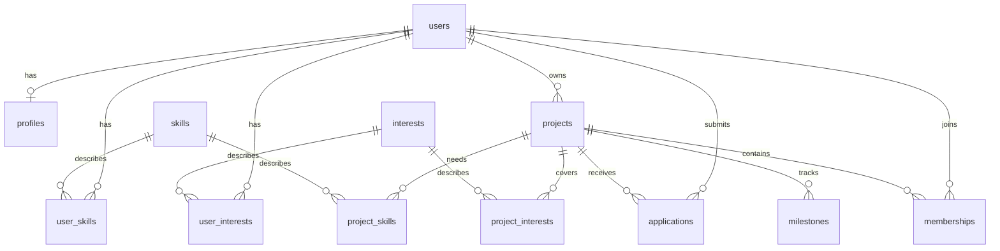

# Backend foundation

The backend is a modular monolith: one FastAPI process and one PostgreSQL database.
The API exposes `/health`, authenticated `GET /me`, and `PATCH /me/profile`.

## Code boundaries

- `app/core/config.py`: Pydantic Settings loaded from environment variables or `backend/.env`.
- `app/core/database.py`: lazy SQLAlchemy engine and one session per dependency call.
  Services will explicitly commit transactions; dependency teardown closes the session
  and rolls back unfinished work. Never share a session between requests.
- `app/core/security.py`: Bearer authentication dependency, passing only a verified UUID.
- `app/modules/auth`: Supabase JWT verification using the project's HTTPS JWKS endpoint.
- `app/modules/users`: self-profile routes, input/output schemas, services, and queries.
- Other feature packages: add routes, Pydantic schemas, services, and repositories
  only as features are implemented. Routes handle HTTP, services handle business
  rules, repositories handle queries. Authentication and permission checks stay at
  their own boundaries; don't trust caller-supplied user IDs.
- `app/models`: shared typed SQLAlchemy models. Importing `app.models` registers
  every table for Alembic without opening a database connection.
- `app/modules/matching`: future pure Python scoring, taking inputs supplied by a
  service. No HTTP or SQLAlchemy imports should be needed by the scoring algorithm.

## Relationships

Entity IDs use PostgreSQL's built-in UUID type. Most entities get Python-generated
UUIDs; `users.id` must be supplied explicitly. A profile shares its user's UUID as
its primary key. Link tables use a pair of UUID foreign keys as a composite primary
key, preventing duplicate links without an extra ID. Applications and memberships
have UUID IDs and a unique constraint on the project/user pair.

Student projects and faculty research opportunities share `projects`, distinguished
by `project_type`. `users.role` supports student, faculty, and administrator;
`faculty_verified_at` is separate and defaults to NULL even for faculty accounts.
A future faculty selection must never imply verification or grant admin access.
Role assignment and verification are trusted operations, not profile edits.

Catalog names are unique, lowercase, and trimmed (for example, `python` and `robotics`).
Future input validation should normalize names before inserting them. Database checks
also reject empty names, invalid enum values, negative experience, and weekly hours
outside 0–168. Foreign keys are indexed directly or by the leading column of a
composite primary key/unique index.

Deleting a project cascades to its links, applications, memberships, and milestones.
Deleting a user cascades to their profile, skills, interests, applications, and
memberships. An owner cannot be deleted while they own a project: transfer ownership
or explicitly delete those projects first. This also affects future Auth account
deletion, because a cascading Auth foreign key would reach this restriction.
Catalog deletion removes links, not users or projects.

Timestamps are timezone-aware. `created_at` uses a database default; `updated_at`
updates on SQLAlchemy-issued updates. Direct SQL/Data API writers will need to set
`updated_at` explicitly or add a reviewed trigger in a later migration.

Application acceptance does not automatically create a membership. Owner membership,
team capacity, research posting permissions, and all other workflows are deferred
to future services and transactions. Nothing in this foundation implements them.
Learning goals and experience have initial fields; scoring semantics and structured
representations can evolve when the recommendation feature is designed.

## Supabase connection and identity

The backend supports a separate private `.env.supabase` connection selected with
`PROJECT_HUB_ENV_FILE=.env.supabase`; `.env` remains the local default. See
[database setup](database-setup.md) for commands. SQLAlchemy and Alembic remain the
owners of the application schema. No Supabase SDK or API keys are needed for this
database connection or public-key JWT verification. Supabase owns sign-in and token
issuance; application passwords and signing secrets are never stored here.

Switching database hosts will use `DATABASE_URL` and optional pool environment
variables, without changing services or repositories. Keep the `postgresql+psycopg`
driver prefix. A separate `DATABASE_PASSWORD` supports special characters without
URL encoding; credentials embedded directly in a URL still need encoding. For a hosted
connection, use the SSL settings and connection string supplied by Supabase. Prefer
the direct connection for migrations (or a session pooler when network access
requires it). Review transaction-pooler restrictions, including prepared statements,
before choosing it; the current configuration targets direct/session connections.

`SUPABASE_URL` selects the trusted Auth issuer. The verifier accepts only ES256 or
RS256 signatures from that project's public signing keys, with matching issuer,
authenticated audience/role, valid timestamps, and UUID subject/session claims.
Anonymous sign-ins and service tokens are rejected. JWKS are cached for five
minutes; key-fetch failures fail closed. JWT verification is stateless, so an
unexpired token can remain valid after logout until expiry; this is not a live
session-revocation check. No token or user metadata grants application privileges.

Revision `cc1194778d46` links `public.users.id` to `auth.users.id` with ON DELETE
CASCADE when the provider schema exists. It leaves plain local PostgreSQL usable
without creating an Auth schema. The cross-schema constraint is managed explicitly
in Alembic and excluded from autogenerate removal. Tests use a minimal Auth stub
only inside rolled-back test transactions. Existing user IDs must match Auth IDs
before applying this migration; it does not remap or discard existing users.

The first authenticated self-profile request provisions a student application user
idempotently. `GET /me` returns the own account and optional profile.
`PATCH /me/profile` creates a profile when given a display name, or partially updates
allowed profile fields. Ownership comes only from the verified subject. Unknown
fields, role changes, faculty verification changes, and identity reassignment are
rejected. Trusted database role/verification values are preserved. Deleting an Auth
identity prevents hosted reprovisioning, even while an old access token is unexpired.

References: [managing user data](https://supabase.com/docs/guides/auth/managing-user-data),
[database connections](https://supabase.com/docs/guides/database/connecting-to-postgres).

## Data API and Row Level Security plan

The initial Alembic migration enables PostgreSQL RLS on all 12 application tables,
with **no client policies**. Non-owner roles cannot read or write rows even if they
have table grants. The local development/migration owner bypasses RLS; this is not
proof of user authorization. The integration suite tests a role without ownership,
superuser privileges, or `BYPASSRLS` to confirm the default denial.

A follow-up migration revokes all table privileges for `PUBLIC` and any existing
`anon`/`authenticated` roles on application tables and Alembic's version table.
It removes the same default table grants for the migration role in `public`.
This covers Supabase's automatic grants and privileges such as TRUNCATE that RLS
does not restrict. The migration leaves access restricted on downgrade; future
client access requires a new explicit grant/policy migration.

Keep the Data API disabled or these tables unexposed until grants and policies are
implemented together in a reviewed Alembic migration. Policy intent for that work:

| Tables | Intended access to design and test |
| --- | --- |
| users | Self-read where needed; role and faculty verification writes stay trusted/server-only |
| profiles, user_skills, user_interests | Own-row edits; decide which profile details other students may read |
| skills, interests | Catalog reads; trusted catalog maintenance |
| projects | Discoverable open projects; draft reads and project edits limited to owner/authorized staff |
| project_skills, project_interests | Follow parent project visibility; owner-authorized writes |
| applications | Applicant and project owner reads; submission/withdrawal and owner review through controlled workflows |
| memberships | Team-scoped reads; trusted acceptance/removal transactions |
| milestones | Team/owner reads and permitted team updates |

Use `TO authenticated` with an ownership/team predicate such as
`(select auth.uid()) = user_id`, not role membership alone. UPDATE policies need
SELECT access and both `USING` and `WITH CHECK` so ownership cannot be reassigned.
Use column grants or server-only updates to protect role and verification fields;
RLS alone does not restrict individual columns. Design project/team lookups without
recursive policies. Test allow and deny cases for anonymous users, owner, unrelated
students, team members, faculty, and administrators, including cross-project ID
changes and privilege escalation. Avoid security-definer shortcuts.

RLS does not restrict table owners or privileged service connections. The
FastAPI authorization layer must enforce permissions when it uses such a connection;
do not assume a verified JWT alone causes SQLAlchemy queries to use `auth.uid()`.

Reference: [Supabase RLS and grants](https://supabase.com/docs/guides/database/postgres/row-level-security).
